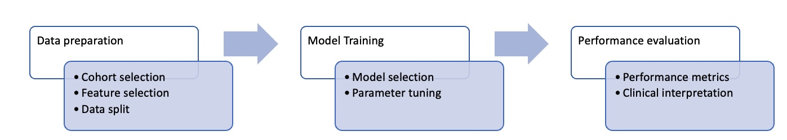
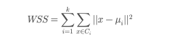
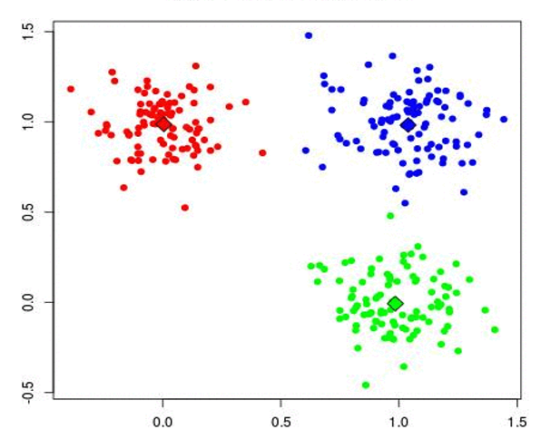

---
--- # YAML metadata (Yet Another Markup Language) 
title: "Module 1.4.3: Code Along"
author:  
  - name: "Ran Xiao"
    email: "ran.xiao@emory.edu"
    affiliation: "Emory University"
format: html
editor: visual
---

# Instruction

-   Fill in the missing codes where you see "your code here"

-   Follow along the course video to complete this.

# Outline

1.  Review of Machine Learning Pipeline
2.  R packages for Machine Learning
3.  R Implementation for Classification
4.  R Implementation for Clustering

# 1. Review of Machine Learning Pipeline

{fig-align="center" width="763"}

# 2. R packages for Machine Learning

**caret** (Classification And Regression Training) is one of the most comprehensive and widely-used machine learning packages in R. 

-   **Data preparation**

    -   **Preprocessing:** scaling, normalization, centering, etc.

    -   **Feature Selection:** selecting important features to prevent overfitting

    -   **Cross-validation** and resampling methods (k-fold, repeated CV, bootstrap)

-   **Model training**

    -   **Extensive Algorithm Support:** Random Forest, SVM, Logistic Regression, Gradient Boosting, with over 200 algorithms seamlessly integrated

    -   **Built-in hyperparameter tuning** with grid or random search

-   **Performance evaluation**

    -   **Comprehensive metrics** (accuracy, ROC, RMSE, AUC, sensitivity, specificity).

-   **Official package link:** <https://cran.r-project.org/web/packages/caret/index.html>

**Other packages for ML**

-   **SuperLearner** <https://cran.r-project.org/web/packages/SuperLearner/vignettes/Guide-to-SuperLearner.html>

-   **tidymodels** <https://www.tidymodels.org/>

-   **xgboost** Extreme Gradient Boosting

-   **randomForest** Random Forest Implementation

-   **e1071:** Support Vector Machine and Naive Bayes Implementation

# 3. R Implementation for Classification

## 3.1. Dataset: Titanic Survival

The [Titanic dataset](https://www.kaggle.com/c/titanic) is a classic example for binary classification tasks in machine learning. It contains information about passengers aboard the Titanic, including demographic details, ticket information, and whether they survived the shipwreck.

The dataset has 1,309 rows and multiple features, such as:

-   **PassengerId**: Unique identifier for each passenger

-   **Pclass**: Passenger class (1st, 2nd, or 3rd class)

-   **Sex**: Gender of the passenger

-   **Age**: Age in years

-   **Fare**: Ticket fare

-   **Embarked**: Port of embarkation (C = Cherbourg, Q = Queenstown, S = Southampton)

-   **SibSp**: \# of siblings / spouses aboard the Titanic

-   **Parch**: \# of parents / children aboard the Titanic

-   **Survived**: Survival status (0 = Did not survive, 1 = Survived)

```{r load titanic}
# Load necessary packages using pacman
pacman::p_load(
  titanic,   # Titanic dataset
  tidyverse, # Collection of packages for data manipulation and visualization
  table1,    # For generating summary tables
  dplyr,     # For data manipulation and transformation 
  caret     # Machine learning package for modeling and data preprocessing
) 

# Load the Titanic training dataset
titanic <- titanic::titanic_train

# Display the first few rows of the dataset
head(titanic)
```

## 3.2. **Exploratory Data Analysis (EDA)**

**Purpose**

-   Understand the structure and distribution of the data.

-   Detect outliers, patterns, and relationships between variables.

This code snippet uses the dplyr::mutate() function to convert several columns in the Titanic dataset into **factor** (categorical) variables. In R, factors are used to handle categorical data, which is especially useful when modeling or summarizing data that falls into discrete groups (e.g., male/female, passenger class, ports of embarkation, etc.).

```{# fill in the code block below}
{r convert-cate-var-2-factor}
### your code here

                         # Create a new dataset `titanic_eda` by modifying `titanic`
 
                         # Convert passenger class (1st, 2nd, 3rd) to a factor
                          # Convert gender (male, female) to a factor
                          # Convert embarkation port (C, Q, S) to a factor
                          # Convert survival status (0 = No, 1 = Yes) to a factor
  )
```

**Uni-variate Analysis:**

Use histograms or boxplots to explore the distribution of predictor variables.

-   For factors (categorical variables):

```{r titanic-cate-var}
# Define a vector of categorical variable names to perform univariate analysis
categorical_vars <- c("Pclass", "Sex", "Embarked")

# Loop through each categorical variable to create a bar plot
for (var in categorical_vars) {
  barplot(
    table(titanic_eda[[var]]), # Create a frequency table for the variable and plot it
    main = var  # Set the title of the bar plot to the variable name
  )
}
```

-   **Uni-variate Analysis:** For continuous variables

```{r titanic-conti-hist}
# Define a vector of numeric variable names
numeric_vars <- c("Age", "Fare", "SibSp", "Parch")

# Loop through each numeric variable and create a histogram
### your code here
}
```

**Multivariate Analysis**

-   Categorical - Survival

```{r}
# Create a bar plot to visualize the survival distribution by passenger class
ggplot(titanic_eda, aes(Pclass, fill=Survived)) +  # Set Pclass on x-axis, fill bars by Survived status

  geom_bar(position="stack") +  # Create a stacked bar chart showing survival proportions per class

  scale_fill_brewer(palette="Set1") +  # Use the "Set1" color palette for categorical differentiation

  ylab("Passengers") +  # Label the y-axis as "Passengers"

  ggtitle("Survived by Class") +  # Set the title of the plot

  theme_minimal()  # Apply a minimal theme for a clean visualization
```

-   Continuous - Survival

```{r}
# Replace missing Age values with the mean age of the dataset
titanic_age <- titanic_eda %>%
  mutate(Age = ifelse(is.na(Age), mean(titanic$Age, na.rm=TRUE), Age))

# Compute the mean age for each survival group (Survived = 0 or 1)
### your code here


# Create a histogram of Age distribution, colored by survival status
ggplot(titanic_age, aes(Age, fill=Survived)) +  
  geom_histogram(aes(y=..count..), alpha=0.5) +  # Plot histogram with semi-transparent bars

  geom_vline(data=tbl_age, aes(xintercept=mean.age, colour=Survived), 
             lty=2, size=1) +  # Add vertical lines indicating the mean age per survival group

  scale_fill_brewer(palette="Set1") +  # Set color palette for fill
  scale_colour_brewer(palette="Set1") +  # Set color palette for vertical lines

  ylab("Density") +  # Label the y-axis as "Density"

  ggtitle("Survived by Age") +  # Set the title of the plot

  theme_minimal()  # Apply a minimal theme for a clean visualization
```

## 3.3 Sample preprocessing

### **Scaling**

Ensures features have comparable ranges, especially important for algorithms sensitive to magnitudes (e.g., SVMs, k-NN). A common target distribution is with a [mean of 0]{.underline} and a [standard deviation of 1.]{.underline}

-   **Sample-wise scaling**

    -   Applied to **each sample (row in the dataset)**, usually having the same scale across all its features. Useful when dealing with image processing or time-series models where the samples have their own inherent scale.

-   **Feature-wise scaling**

    -   Applied to **each feature (column in the dataset)** across all samples, normalizing each feature independently, important when features vary greatly in magnitude. Helping with the equality of feature contribution in the algorithms sensitive to feature scales like k-NN, SVMs, and gradient descent-based methods.

-   **Common Methods:**

    -   **Min-Max Scaling:** Rescales data to \[0, 1\] using `scales::rescale()` or `caret::preProcess()`.

    -   **Z-Score Normalization:** Centers data around the mean with a standard deviation of 1 using `scale()` in R.

### **Balancing**

Imbalanced datasets can lead to biased models.

-   **Techniques:**

    -   **Oversampling:** Duplicate or synthesize minority class samples using techniques like SMOTE .

    -   **Undersampling:** Reduce majority class samples using random sampling.

    -   **Weight Adjustment:** Modify class weights to penalize misclassification of minority classes.

### **Handling Missingness**

-   **Type of Missingness:**

    -   *missing completely at random* (MCAR)

        -   The missing data has **no pattern** and is **not related** to any other variables in the dataset.

        -   e.g., a survey to collect participants' weight, some responses are missing because participants got distracted and forgot to answer the question.

    -   *missing at random* (MAR)

        -   The missing data is **systematically related to another observed variable**, but **not to the missing value itself**.

        -   e.g., younger participants are more likely to skip the weight questions because they care less about their weight

    -   *missing not at random* (MNAR)

        -   The missing data is related **to the value of the missing data itself**.

        -   People who **consider themselves overweight** are **more likely to leave the question blank** because they feel uncomfortable sharing their weight.

-   **Omission Techniques**:

    -   **Dropping Data**: Remove samples or features with excessive missingness.

-   **Imputation Techniques**:

    -   **Mean/Median/Mode Substitution**: Impute missing values using mean, median, or mode

    -   **Predictive Imputation**: Use regression or k-NN for imputing missing values

    -   **Forward Filling**: In time series data, fill missing values by carrying forward the previous value.

-   **Advanced Methods**: Use [autoregressive (AR) models](https://online.stat.psu.edu/stat501/lesson/t/t.2/t.2.1-autoregressive-models) or [Kalman filters](https://www.cs.cmu.edu/~motionplanning/papers/sbp_papers/kalman/kleeman_understanding_kalman.pdf) to handle missing data in time series.

### Practice

For titanic dataset, we just need to scale and impute the missingness, which can all done with [`caret::preProcess()`](https://cran.r-project.org/web/packages/caret/caret.pdf "preProcess()") - explain more about function

Drop PassengerId, Name, etc.

```{r titanic-before-pre}
# drop PassengerId, Name
titanic <- titanic[, !(names(titanic) %in% c("PassengerId", "Name", "Ticket", "Cabin"))]
head(titanic)
```

Check balance of outcome:

```{r titanic-check-balance}
ggplot(
  data = titanic,  # Use the Titanic dataset
  mapping = aes(x = factor(Survived), fill = factor(Survived))  
  # Set 'Survived' as the categorical variable for the x-axis
  # Use the same 'Survived' variable for fill color to differentiate classes
  ) +
  geom_bar(position = "dodge")  
  # Create a bar plot showing the count of survivors vs. non-survivors
  # 'position = "dodge"' ensures bars do not stack but are placed side by side
```

Check missingness:

```{r titanic-check-missing}
pacman::p_load(
  naniar  # Load the 'naniar' package to check for missing data
)

gg_miss_var(titanic) +  
  # Create a bar plot showing the number of missing values per variable
  labs(title = "Missing Data by Variable")  
  # Add a title to the plot for better readability

vis_miss(titanic, sort_miss = TRUE) +  
  # Generate a heatmap-style visualization of missing data
  # 'sort_miss = TRUE' sorts variables by the proportion of missing values
  labs(title = "Missing Data Patterns")  
  # Add a title to explain the visualization
```

Three imputation method used in caret::preProcess(): knnImpute, bagImpute, medianImpute

```{r}
# Select only feature variables and convert categorical variables to numeric
titanic_feature <- titanic %>% 
  select(-Survived) %>%  # Remove the target variable "Survived"
  mutate(
    # Convert "Sex" to numeric: male = 1, female = 0
    Sex = as.numeric(ifelse(Sex == "male", 1, 0)),
    
    # Convert "Embarked" to numeric: Q = 1, C = 2, S = 3, missing values remain NA
    Embarked = as.numeric(case_when(
      Embarked == "Q" ~ 1,
      Embarked == "C" ~ 2,
      Embarked == "S" ~ 3,
      TRUE ~ NA_real_  # Keeps missing values as NA
    ))
  )

# Build a preprocessing method
### your code here

# "center" - Subtracts the mean from each value
# "scale" - Divides by the standard deviation (standardization)
# "medianImpute" - Replaces missing values with the median of the column

# Apply the preprocessing transformations to the dataset
### your code here

# Create the final processed dataset
titanic_processed <- titanic_feature_processed  # Copy the preprocessed features
titanic_processed$Survived <- factor(titanic$Survived)  # Add back the target variable as a factor

# Display the first few rows of the final dataset
head(titanic_processed)
```

```{r}
# Display a summary of the processed Titanic dataset
summary(titanic_processed)  
# Provides a summary of each column, including min, max, mean, median, and missing values.
cat("\n\n")  # Adds two blank lines for spacing

# Count the number of missing values in each column
colSums(is.na(titanic_processed))  
# 'is.na()' checks for missing values and 'colSums()' counts them column-wise.
cat("\n\n")  # Adds two blank lines for spacing

# Display the distribution of the 'Survived' variable
table(titanic_processed$Survived)  
# Counts the number of occurrences of each category (0 = did not survive, 1 = survived).
```

## 3.4 Feature Engineering

Crucial for improving the performance of machine learning models. It involves transforming raw data into a format that is more suitable for modeling and optimizing predictive power.

### 3.4.1 Feature reduction

#### (**a) Low-Variance Feature Reduction**

-   Remove features with very low variance, as they provide little predictive power. Features with constant or near-constant values should be excluded as they don’t contribute to differentiating between observations.

-   **Techniques:** Use statistical measures like variance or standard deviation to identify and remove low-variance features.

#### (**b) Collinearity Feature Reduction**

-   Remove or combine features that are highly correlated with one another (multicollinearity), as they can lead to unstable model estimates.

-   **Techniques:** Identify correlation matrices to spot pairs of highly correlated variables. Use dimensionality reduction (PCA) to combine correlated features.

#### (**c)** Practice

```{r feature-reduction-pkgs}
# Load required packages using pacman::p_load(), which installs them if missing
pacman::p_load(
  caret,     # For machine learning and feature selection 
  dplyr,     # For data manipulation and transformation 
  corrplot   # For visualizing correlation matrices
)
```

**Identify low-variance features**

```{r titanic-low-variance}
# nearZeroVar() finds features with very little variance (i.e., almost constant across samples)
### your code here

# 2. Print the names of identified low-variance features
cat("The low-variance features:", rownames(low_var_features)[low_var_features$nzv]) 
# If no features are printed, it means no near-zero variance features exist.

# 3. Remove low-variance features from the dataset
titanic_feature_processed <- titanic_feature_processed[, !low_var_features$nzv]
```

**Collinearity Feature Reduction**

```{r titanic-collinearity}

# Compute the correlation matrix for the dataset, using only complete observations
### your code here

# Visualize the correlation matrix using a color-coded heatmap
corrplot::corrplot(correlation_matrix, method = "color") 

# Identify highly correlated features (absolute correlation > 0.8)
high_cor_features <- findCorrelation(correlation_matrix, cutoff = 0.8) 

# Print the names of highly correlated features, if any
cat("The highly correlated features:", colnames(correlation_matrix[, high_cor_features])) 

# If there are highly correlated features, remove them from the dataset
if(length(high_cor_features) > 0) {
  titanic_feature_processed <- titanic_feature_processed[, -high_cor_features]
}
```

```{r titanic-update-processed-data}
# Combine the processed feature dataset with the target variable "Survived"
titanic_processed <- cbind(
  titanic_feature_processed,  # Processed feature dataset after scaling, imputation, and feature selection
  Survived = titanic_processed$Survived  # Add back the original "Survived" column as the target variable
)

# Display the first few rows of the updated dataset
head(titanic_processed)
```

### 3.4.2 Feature selection

#### **(a) Wrapper Methods**

-   These methods evaluate the performance of a model based on subsets of features. They use a search algorithm to find the optimal feature subset by evaluating model performance with each combination. Used in relatively small dataset, large computational resource required.

-   **Techniques:** Forward selection, backward elimination, and recursive feature elimination (RFE).

#### (**b) Filter Methods**

-   These methods rank features based on statistical tests, and then select the best features based on their relevance to the target variable.

-   **Techniques:** Chi-square test, information gain, ANOVA, correlation-based feature selection.

#### (c) Practice

```{r feature-selection-pkgs}
pacman::p_load(
  FSelector  #filter method
)
```

Filter Method:

```{r titanic-filter}
# 1. Calculate Information Gain for Feature Selection
### your code here

# Computes information gain for each feature in relation to the target variable "Survived"
# Higher values indicate more important features

# Arrange info_gain dataframe in descending order by attr_importance
info_gain <- info_gain %>%
  arrange(desc(attr_importance))

# Print the reordered dataframe
print(info_gain)
```

Wrapped method:

```{r titanic-wrapped-method}
# 1. Set Up Recursive Feature Elimination (RFE) Control
control <- rfeControl(
  functions = rfFuncs, # Uses Random Forest as the feature selection method
  method = "cv",       # Applies cross-validation to evaluate feature importance
  number = 5           # Uses 5-fold cross-validation
)

# 2. Perform Recursive Feature Elimination (RFE)
### your code here


# 3. Extract the Selected Features
selected_features <- predictors(rfe_results) # Retrieves the best-performing features
cat("The selected features:", selected_features) # Displays the chosen features in console

# 4. Update the Processed Feature Set
titanic_feature_processed <- titanic_feature_processed %>% select(all_of(selected_features))
# Retains only the selected features in the dataset

# 5. Reconstruct the Titanic Processed Dataset
titanic_processed <- cbind(titanic_feature_processed, Survived = titanic_processed$Survived)
# Merges the selected features with the target variable ("Survived") for further analysis
```

## 3.5. Model Development

Involves selecting, training, and optimizing a machine learning model that best fits the data and provides accurate predictions.

### 3.5.1 Data Split

#### (**a) Data Splitting**

-   Separate data into training, validation, and testing sets to evaluate model performance on unseen data.

-   **Training-Validation-Testing considering:** (80%, 10%, 10%), (60%, 20%, 20%)

**Tools in R:**

-   [**`caret::createDataPartition()`**](https://cran.r-project.org/web/packages/caret/caret.pdf): This function in the `caret` package is useful for creating training and test sets using **stratified sampling**, which maintains the distribution of the target variable across the splits (important for imbalanced datasets).

#### (**b) K-Fold Cross-Validation**

-   A robust technique for evaluating model performance by splitting data into K equal-sized subsets (or "folds") and iteratively training and testing the model on different subsets. It helps reduce overfitting by providing a more reliable estimate of model performance. Also good to used in imbalanced dataset.

-   **Steps**

    1.  **Split the data** into **K equal-sized subsets** (folds).

    2.  **Train the model** on **K-1 subsets** and test it on the **remaining subset**.

    3.  **Repeat** the process K times, each time using a different fold as the test set.

    4.  **Average** the results of the K iterations to get the final performance metric.

-   **Considerations**

    -   **Group Label/ID**: When the dataset has repeated observations for the same group (e.g., multiple measurements for a single patient), care must be taken to ensure that all observations for the same group are in the same fold to avoid **data leakage**. This ensures that the model is not tested on data from the same subject it has already seen during training.

    -   **Group K-Fold Cross-Validation**: This variation ensures that data from the same group (e.g., a single patient) does not appear in both the training and testing sets. In this case, you need to perform the split based on group identifiers (e.g., patient IDs) to prevent leakage. (`rsample::groupKFold()` )

-   **Tools in R:**

    -   [`caret::trainControl()`](https://cran.r-project.org/web/packages/caret/caret.pdf) for automating cross-validation.

    -   `rsample` or `mlr` packages for advanced sampling strategies.

#### (c) Practice

```{r titanic-data-split}
# 1. Set a Random Seed for Reproducibility
set.seed(123)  
# Ensures consistent results every time the script is run

# 2. Split Data into Training and Testing Sets
### your code here


# 3. Create Training and Testing Data
titanic_train <- titanic_processed[train_index, ]  # Extracts training data using indices
titanic_test <- titanic_processed[-train_index, ]  # Extracts remaining 20% as test data

# 4. Create a Feature-Only Test Set (Excludes "Survived" Column)
titanic_test_feature <- titanic_test %>% select(-Survived) 

# 5. Display the Number of Rows in Training and Testing Sets
cat(
  "Train:\t\t", nrow(titanic_train),  # Print the number of training samples
  "\nTest:\t\t", nrow(titanic_test)   # Print the number of testing samples
)
```

### 3.5.2 Model selection

These models learn from labeled data to predict an outcome. Common supervised learning algorithms include:

-   logistic regression, decision trees, support vector machines, random forests, gradient boosting.

```{r model-selection-pkgs}
pacman::p_load(
  caret,    # For building and evaluating models, including confusionMatrix() and grid search
  e1071,    # Contains implementations for Naive Bayes and Support Vector Machines (SVM)
  rpart,    # Decision tree implementation for classification and regression tasks
  ranger    # Random forest implementation optimized for speed and efficiency
)
```

#### Using logistic regression

-   The titanic dataset have a binary outcome and small number of features, **logistic** model is very suitable for it:

```{r titanic-logit}
# Train a logistic regression model using the Titanic dataset
### your code here

# Display the summary of the logistic regression model
summary(titanic_logit_model)

# Predict survival probabilities on the test dataset using the trained logistic regression model
predictions <- ifelse(predict(titanic_logit_model, newdata = titanic_test, type = "response") >= 0.5, 1, 0)

# Compute and display the accuracy of the logistic regression model on the test dataset
confusionMatrix(as.factor(predictions), titanic_test$Survived)$overall[['Accuracy']]

```

-   **Note:** Sex, Pclass, Age are significant, indicating their importance of predicting survival.

#### Using other models

-   Naive Bayes, Support Vector Machine and Decision Tree

```{r titanic-nb-svm-dt}
cat("Naive Bayes\n")
### your code here
predictions <- predict(titanic_nb_model, newdata = titanic_test)
confusionMatrix(as.factor(predictions), titanic_test$Survived)$overall[['Accuracy']]

cat("Support Vector Machine\n")
### your code here
predictions <- predict(titanic_svm_model, newdata = titanic_test)
confusionMatrix(as.factor(predictions), titanic_test$Survived)$overall[['Accuracy']]

cat("Decision Tree\n")
### your code here
predictions <- predict(titanic_dt_model, newdata = titanic_test)
confusionMatrix(as.factor(predictions), titanic_test$Survived)$overall[['Accuracy']]

cat("Random Forest\n")
### your code here
predictions <- predict(titanic_rf_model, newdata = titanic_test)
confusionMatrix(as.factor(predictions), titanic_test$Survived)$overall[['Accuracy']]
```

# 4. R Implementation for Clustering

## Clustering with K-Means algorithm

### **4.1 Exploratory Data Analysis (EDA)**

The [Mall Customer Segmentation](https://www.kaggle.com/datasets/vjchoudhary7/customer-segmentation-tutorial-in-python/data) Dataset is a commonly used dataset for clustering analysis, often applied in customer behavior studies. It contains data on 200 customers, with four key attributes that describe each customer:

-   **Annual Income**: The customer's annual income (in thousands of dollars).

-   **Spending Score**: A score assigned to each customer (from 1 to 100) based on their spending behavior.

-   **Gender**

-   **Age**

```{r}
#Load necessary libraries
library(table1) # used to produce descriptive statistics tables
library(dplyr) # Load dplyr package for data manipulation
library(ggplot2)   # For visualization
library(cluster)   # For clustering algorithms
library(factoextra) # For visualizing clustering results
```

```{r}
# Load the dataset
mall <- read.csv(here::here("Mall_Customers.csv")) 
# Rename columns for better readability
colnames(mall) <- c("id", "gender", "age", "annual_income", "spending_score")
# Display the first few rows of the dataset
head(mall)
```

```{r}
# summary statistics
table1(~., data = mall %>% select(-id)) 
# ~ . specifies that you want to summarize all variables present in the provided data.
# mall %>% select(-id) uses the dplyr package to remove (-) the variable named id from the dataset mall
```

### **4.2 Data Preprocessing**

Convert categorical variables (like gender) into numeric format, and remove non-numeric ID columns from clustering:

```{r}
# Remove ID for clustering
mall_numeric <- mall[, -1] 
# Convert gender to numeric
mall_numeric$gender <- as.numeric(as.factor(mall_numeric$gender)) 
head(mall_numeric)
```

### **4.3 Determine Optimal Number of Clusters**

Using the Elbow Method to find the ideal number of clusters (k):

WSS (Within-Cluster Sum of Squares) is a metric used in **K-means clustering** to measure how tightly data points are clustered around their respective centroids.

{fig-align="center"}

{fig-align="center"}

```{r}
# Set a seed for reproducibility
set.seed(1)
# Create an empty numeric vector to store WSS values for different k values
wss <- vector()
# Loop through different values of k (1 to 10) to compute WSS
### your code here


# Plot Elbow method
plot(1:10, wss, type = "b", 
     main = "Elbow Method for Optimal Clusters",
     xlab = "Number of clusters (k)", 
     ylab = "Total Within-Cluster Sum of Squares")
```

### **4.4 Apply K-Means Clustering**

```{r}
set.seed(1)
# Run K-means clustering with the optimal number of clusters
### your code here
# Add cluster information to the original dataset
mall$cluster <- as.factor(final_clusters$cluster)
head(mall)
```

### **4.5 Visualize Clusters**

```{r}
library(ggplot2)

ggplot(mall, aes(x = annual_income, y = spending_score, color = cluster)) +
  geom_point(size = 3, alpha = 0.8) +
  labs(title = "Mall Customer Segmentation", 
       x = "Annual Income",
       y = "Spending Score") +
  theme_minimal() +
  scale_color_brewer(palette = "Set1")
```

### **4.6 Cluster Profiling**

```{r}
mall %>%
  group_by(cluster) %>%  # Group data by the 'cluster' variable
  summarise(
    average_spending_score = mean(spending_score, na.rm = TRUE),  # Compute the average spending score
    total_customers = n(),  # Count the number of customers in each cluster
    total_females = sum(gender == "Female", na.rm = TRUE),  # Count the number of females in each cluster
    average_age = mean(age, na.rm = TRUE),  # Compute the average age
    average_annual_income = mean(annual_income, na.rm = TRUE)  # Compute the average annual income
  ) %>%
    arrange(desc(average_spending_score)) %>%  # Order by average spending score in descending order
  ungroup()  # Remove grouping after summarization to return a regular dataframe
```
